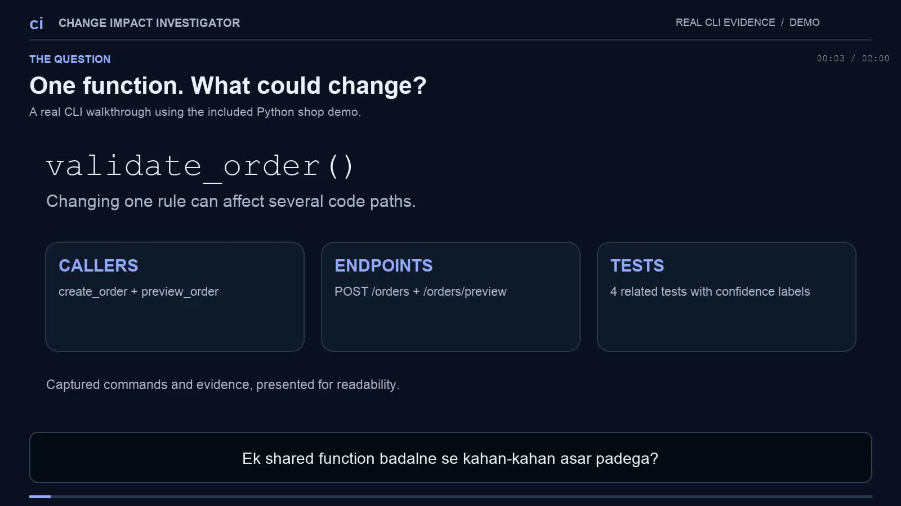
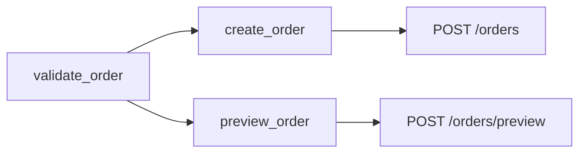

<div align="center">

# Change Impact Investigator

### Understand the impact before you edit.

Trace callers, imports, API endpoints, and related tests across Python and TypeScript.<br>
Inspect source evidence, save a baseline, and see what changed after the edit.

[](https://github.com/kvianAR/change-impact-investigator/actions/workflows/ci.yml)
[](https://github.com/kvianAR/change-impact-investigator/releases/latest)
[](#quick-start)
[](#language-and-framework-support)
[](LICENSE)

[Watch the demo](#watch-the-2-minute-demo) · [Quick start](#quick-start) · [Models panel](#your-provider-your-model) · [MCP setup](docs/USAGE.md#connect-an-mcp-client)

</div>

---

## Watch the 2-minute demo

[](https://github.com/kvianAR/change-impact-investigator/releases/download/v0.3.0/change-impact-investigator-demo.mp4)

<div align="center">

**[Open / download the video](https://github.com/kvianAR/change-impact-investigator/releases/download/v0.3.0/change-impact-investigator-demo.mp4)** · **[Download subtitles](https://github.com/kvianAR/change-impact-investigator/releases/download/v0.3.0/change-impact-demo-hi.srt)**

2 minutes · Roman Hinglish subtitles · Silent walkthrough · Actual captured CLI evidence

</div>

| Jump to | What the walkthrough covers |
| --- | --- |
| **00:08** | Choose a function and trace its callers |
| **00:30** | Find connected endpoints and related tests |
| **00:54** | Save a baseline, then change the validator |
| **01:14** | Reinspect the Git diff and compare connections |
| **01:36** | Run tests and review what static analysis can establish |

The video presents real CLI evidence in a readable terminal layout. It shows three intentional test failures after lowering the demo validator's quantity limit. Subtitles are burned into the video and included as a selectable track. A separate [SRT file](docs/media/change-impact-demo-hi.srt) is also available.

## “If I change this function, what else could be affected?”

A shared validator can sit behind several services, routes, and tests. Change Impact Investigator follows those relationships and returns file-and-line references your coding agent can inspect.

| Your question | Evidence the tool provides |
| --- | --- |
| **Who calls this?** | Direct and transitive callers, imports, aliases, and supported method relationships |
| **Which endpoints can this reach?** | Supported FastAPI, Flask, Django, and Express registrations |
| **Which tests should I review?** | Related tests, pytest fixture links, and HTTP request candidates |
| **What does this Git diff affect?** | Impact from staged, unstaged, untracked, and deleted source files |
| **What changed after my edit?** | Source changes and added or removed graph connections |
| **Where is the analysis uncertain?** | Dynamic calls, candidate matches, diagnostics, and traversal limits |

> Core investigation runs locally without an API key. Optional AI summaries add a readable explanation alongside the original evidence.

## A shared validator, two affected endpoints

The included shop example answers the question with a small, runnable codebase.



*Connections show potential impact from the validator toward its callers and endpoints.*

The same investigation finds four related demo tests. Each report carries source locations so you can inspect the connections yourself.

```sh
# From the tool checkout, after installation
change-impact inspect-change-impact \
  --repo . \
  --symbol examples.shop.validators:validate_order
```

For the full before-and-after demo, install the demo dependencies and run the script.

```sh
pip install '.[dev,demo]'
python -m pytest examples/shop -q
python scripts/run_demo.py
```

The script creates an isolated demo under `.impact-cache/demo`, changes the validator, adds an endpoint, and saves a comparison report. Use `--directory` to choose a fresh destination for another run.

## Quick start

### 1. Install from the repository

You need **Python 3.11+** and **Git**.

```sh
git clone https://github.com/kvianAR/change-impact-investigator.git
cd change-impact-investigator
python -m venv .venv
source .venv/bin/activate
pip install '.[panel,mcp]'
```

On Windows, activate with `.venv\Scripts\Activate.ps1` in PowerShell. For core analysis alone, install with `pip install .`.

### 2. Investigate a function or the current diff

```sh
# Trace a function and its callers
change-impact trace-callers \
  --repo /path/to/repo \
  --symbol package.validators:validate_order

# Find related tests
change-impact related-tests \
  --repo /path/to/repo \
  --symbol package.validators:validate_order

# Inspect the current Git changes
change-impact inspect-change-impact --repo /path/to/repo

# Compare against a branch with a deeper traversal
change-impact inspect-change-impact --repo /path/to/repo --base main --depth 12
```

Commands return JSON with source evidence. Python is the default language. See the [usage guide](docs/USAGE.md) for complete setup and examples.

### 3. Save a baseline, edit, and compare

```sh
change-impact baseline \
  --repo /path/to/repo \
  --symbol package.validators:validate_order

# Edit the code, then use the baseline_id returned above
change-impact compare --repo /path/to/repo --baseline-id BASELINE_ID
```

Comparison records source changes plus added and removed callers, routes, imports, tests, and dynamic calls. Named symbols and tests retain identity across line movement. Removed connections keep their earlier source references.

## Your provider, your model

**Version 0.3 introduces a local Models panel** for saved model profiles, provider keys, and active-model switching.

```sh
change-impact models
```

Open the local panel at `http://127.0.0.1:8765` and configure your model.

1. Choose **Add model** and select a provider.
2. Use **Browse models** or enter the exact model ID manually.
3. Enter the provider API key when required.
4. Choose **Save & activate**.
5. Add more profiles and use **Make active** whenever you want to switch.

**Connections** lets you update a provider key later. An empty key field preserves the saved key. Display names and output limits belong to each model profile. Keys and endpoints are shared across profiles for the same provider. Custom API supports one shared endpoint.

| Provider | Connection | What you supply |
| --- | --- | --- |
| **OpenRouter** | Online · Chat Completions | API key and a full `provider/model` ID |
| **OpenAI** | Online · Responses API | API key and a supported model ID |
| **Ollama** | Local · generate API | A running Ollama server and an already-pulled model |
| **Custom API** | OpenAI-compatible Chat Completions | HTTPS base URL, model ID, and an optional API key |

A manual model ID works even when catalog discovery is unavailable. **Test model** sends a short prompt to the selected provider and may incur charges.

```sh
# Use the saved active model from CLI or MCP
change-impact summarize --repo /path/to/repo --symbol validate_order

# Explicit OpenRouter selection, with OPENROUTER_API_KEY set in the environment
change-impact summarize --repo /path/to/repo --symbol validate_order \
  --provider openrouter --model vendor/model-name

# Local Ollama, with the model already pulled
change-impact summarize --repo /path/to/repo --symbol validate_order \
  --provider ollama --model qwen3.5:2b-q4_K_M
```

<details>
<summary><strong>Credential storage, endpoints, and data sent to AI</strong></summary>

API keys entered in the panel go into the operating-system keychain. Supported backends include macOS, Windows, SecretService, and KWallet. If secure storage is unavailable, use environment keys.

- OpenRouter uses `OPENROUTER_API_KEY` as its environment fallback.
- OpenAI uses `OPENAI_API_KEY`.
- Custom API uses `CHANGE_IMPACT_CUSTOM_API_KEY`.
- Ollama defaults to `http://127.0.0.1:11434`. HTTP endpoints are supported on loopback. Remote custom endpoints require HTTPS.

Metadata-only model settings live outside the repository. On macOS, the default is `~/Library/Application Support/ChangeImpactInvestigator`. Other platforms use their configuration directory. Set `CHANGE_IMPACT_CONFIG_DIR` to override it.

The panel binds to `127.0.0.1`, validates Host and Origin, and uses a per-launch API session token. For headless use or another port, run `change-impact models --no-browser --port 8765`.

Remote summaries send a bounded projection of report evidence, including repository paths, symbol names, routes, and test references. `summary_scope` records omissions. The response includes the original local evidence report.

</details>

## Give your coding agent the same tools

Configure a stdio MCP server with command `change-impact-mcp`. Tool calls accept an absolute `repo` path and a `language` argument.

| MCP tool | Use it to |
| --- | --- |
| `index_repository` | Build or refresh an index and inspect reuse statistics |
| `trace_callers` | Follow callers with source evidence |
| `inspect_change_impact` | Investigate a symbol or Git diff |
| `find_related_tests` | Find connected tests and candidates |
| `create_impact_baseline` | Save an investigation before editing |
| `compare_impact` | Compare source and connections after editing |
| `summarize_impact` | Explain evidence with the active or explicitly selected AI model |

See the [MCP client setup](docs/USAGE.md#connect-an-mcp-client) for configuration and registration instructions.

## Language and framework support

| Area | Supported analysis |
| --- | --- |
| **Python** | Lexical scopes, imports and re-exports, C3 inheritance, `super`, typed receivers, and constructor-based method inference |
| **Python web frameworks** | Supported FastAPI dependencies/factories, Flask blueprints/factories, and Django URL/view registrations |
| **Python tests** | pytest functions, fixture relationships, and supported HTTP request candidates |
| **TypeScript** | Compiler-backed symbol relationships, aliases, inherited methods, and Express routes/middleware |
| **TypeScript tests** | Named `test`/`it` callbacks and supported HTTP request candidates |
| **Mixed repositories** | Combined Python and TypeScript reports with `--language auto` |

For TypeScript, install the compiler runtime in the tool checkout. You need **Node.js 20+** and a trusted TypeScript compiler. The runnable example uses **Node.js 22.18+**.

```sh
npm ci --ignore-scripts

change-impact trace-callers --repo /path/to/ts-repo \
  --language typescript --symbol src/validators.ts:validateOrder

change-impact inspect-change-impact --repo /path/to/mixed-repo --language auto

# Execute the TypeScript example tests against an Express server
npm test
```

<details>
<summary><strong>Evidence, analysis limits, and index caching</strong></summary>

## Evidence you can inspect

Call edges include the call site and target definition. Import evidence records the alias, target, file, line, and lexical scope. Constructor-based inference is labeled. Reports include source hashes, parse diagnostics, duplicate-module diagnostics, and traversal truncation flags.

- **Current connections** carry `evidence_state="working_tree"`.
- **Deleted functions** use source from the selected Git revision and carry `evidence_state="base"`.
- **Module-level changes** conservatively mark that module's functions as potentially affected.
- **HTTP path matches** carry `confidence="candidate"`.
- **Unresolved dynamic calls** expose uncertainty. Repository-wide unresolved calls have an unknown relationship to the selected symbol.

Runtime dispatch, external base classes, complex factories, monkey patching, and plugin registries can require manual review. Framework adapters inspect supported static registrations. The [advanced analysis guide](docs/ADVANCED.md) explains the supported patterns and remaining limits.

## Built for repeated investigations

Snapshots and indexes live in `.impact-cache/` inside the inspected repository, with private directory permissions and a cache-specific Git ignore file.

Python indexes reuse unchanged files. TypeScript reuses a complete compiler result while project inputs remain unchanged and rebuilds after edits. `index_stats` exposes reuse. Set `CHANGE_IMPACT_CACHE=off` to disable persistence.

```sh
change-impact index --repo /path/to/repo
```

Source analysis reads project files without importing or executing project code. TypeScript analysis runs the trusted Node/compiler runtime.

</details>

## Verification and development

Version 0.3 passed **96 Python tests**, **3 executable Node tests**, and GitHub CI on **Python 3.11 and 3.12**. Pinned repository benchmarks and the verification record document the tested scope.

The Models panel was browser-tested for save, edit, activation, provider key updates, and persistence using isolated test credentials. The live OpenRouter public catalog was checked. Live OpenRouter inference remains pending a user API key.

```sh
uv sync --all-extras --no-editable
source .venv/bin/activate
npm ci --ignore-scripts

python -m pytest -q
npm test
ruff check .
ruff format --check .
```

## Explore the project

| Read | Find |
| --- | --- |
| [Usage guide](docs/USAGE.md) | Installation, CLI workflows, AI setup, and MCP configuration |
| [Architecture](docs/ARCHITECTURE.md) | Indexing, graph relationships, snapshots, and provider transport |
| [Advanced analysis](docs/ADVANCED.md) | Framework patterns, inference behavior, and analysis limits |
| [Benchmarks](benchmarks/README.md) | Pinned repositories, accuracy cases, and performance measurements |
| [Verification record](VALIDATION.md) | Checks performed and remaining live-provider verification |
| [Changelog](CHANGELOG.md) | Release-by-release changes |
| [Roadmap](ROADMAP.md) | Completed development rounds |

---

<div align="center">

[Watch the demo](#watch-the-2-minute-demo) · [Get the latest release](https://github.com/kvianAR/change-impact-investigator/releases/latest) · [Report an issue](https://github.com/kvianAR/change-impact-investigator/issues) · [MIT license](LICENSE)

</div>
