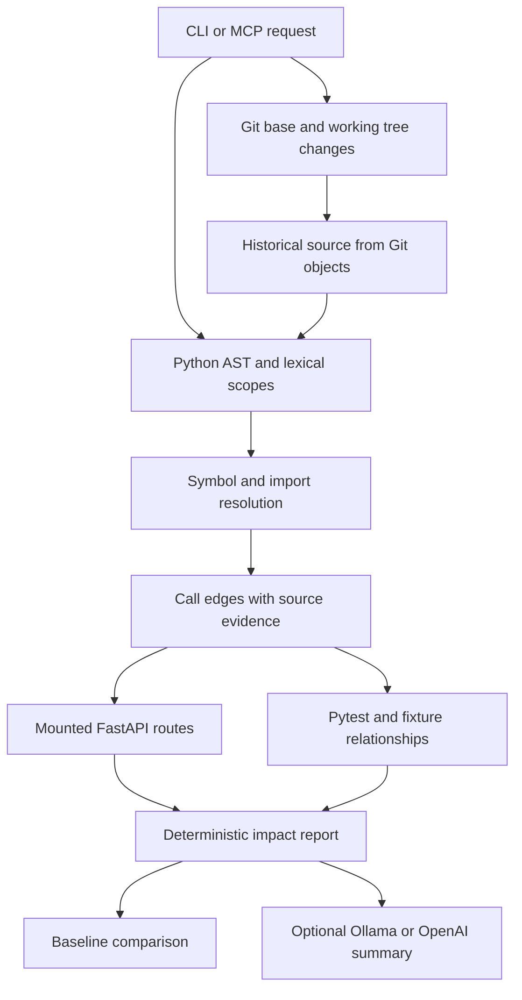

# Analysis design

## Source and symbol index

Git-aware enumeration respects ignored files. Standard environment, build, and generated cache directories are excluded. Symlink files are skipped. Python encoding declarations are supported. Syntax and decoding failures produce diagnostics.

The index records functions, classes, methods, lambdas, imports, lexical bindings, and call sites. Conventional `src/` layouts are supported. Duplicate module identities are diagnosed and excluded from resolution.

Lexical resolution handles local definitions, explicit imports, aliases, relative imports, re-exports, nested functions, module-qualified calls, method receivers, and simple constructor-created instances. Constructor inference has its own resolution label. Parameters and assignments prevent unrelated same-name functions from being linked.

## Graph traversal

Each resolved edge records its caller, target, source call location, target definition location, expression, and resolution method. Reverse traversal produces caller paths. Path-specific visited sets prevent recursive cycles while preserving alternate paths. Depth and path-count limits produce a truncation flag.

Unresolved calls remain separate from resolved graph edges. The unresolved list covers the repository. A dynamic target can have an unknown relationship to the selected symbol.

## Git changes

The analyzer reads current files and the selected commit's Python blobs without checking out or executing historical code. Deleted symbols keep base-revision evidence. Function body, signature, and decorator changes map to their containing symbol. Module-level edits conservatively affect functions in that module. Non-Python files are listed separately.

Comment and formatting changes with an unchanged module AST are listed as non-semantic changes. They produce no inferred code impact in diff-based reports.

Parse failures preserve historical evidence with a distinct reason. Baseline comparison stops when a selected symbol's current file cannot be indexed. A parse failure therefore remains distinguishable from a deletion.

## Framework relationships

FastAPI adapters identify public `FastAPI` and `APIRouter` constructors, literal route paths, HTTP methods, and top-level `include_router` calls. Mounted prefixes are composed through nested routers. Mount evidence includes every registration location. Dynamic prefixes, unresolved mounts, cycles, depth limits, unmounted routers, and reassigned router variables produce diagnostics.

Pytest discovery follows default test filename and Test-class naming patterns. Direct call paths provide static links. Fixture parameters, local/imported/conftest fixtures, transitive fixture dependencies, autouse fixtures, and function-level usefixtures markers add fixture evidence. Literal HTTP calls can match parameterized routes and query strings. HTTP matches are candidates because receiver behavior is not proven by a method name.

## Snapshots and AI

Baseline JSON stores the investigation evidence. Symbol AST fingerprints distinguish source edits from line movement. Connection identities omit line numbers so moved references retain their relationships. Removed edges keep their earlier locations.

AI receives a bounded evidence projection. Scope counts expose omitted impacts, routes, tests, paths, and unresolved calls. The original deterministic report is returned alongside the summary. Provider transport uses environment-based credentials and bounded responses.

## Supported limits

- Source syntax must be understood by the Python interpreter running the analyzer.
- Custom source roots, runtime import hooks, inheritance dispatch, monkey patching, and decorator replacement can remain unresolved.
- Application factories, runtime route registration, FastAPI dependency injection, WebSocket routes, Flask, and Django are outside the current route adapter.
- Pytest plugins, custom collection rules, runtime fixture lookup, complex fixture overrides, and class-level markers can require manual investigation.
- External installed dependency source and constant/dataflow dependencies are outside the repository call graph.
- Each request builds an in-memory index. Persistent incremental indexing and large-repository accuracy benchmarks remain future work.
- A static path indicates possible reachability. Behavioral breakage requires review or execution of relevant tests.
